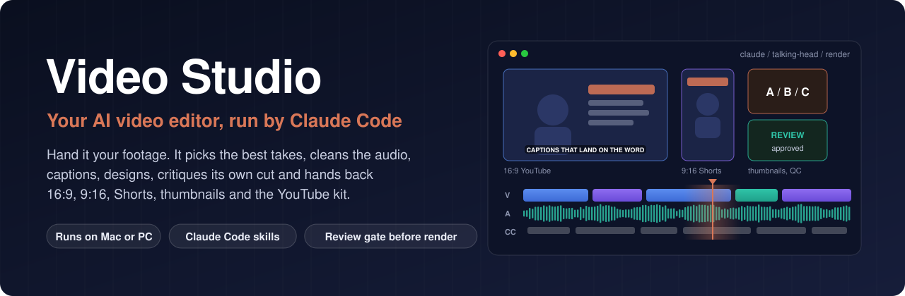
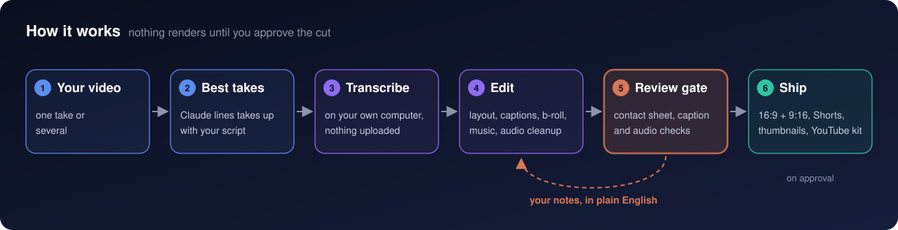

<p align="center">
  
</p>

<p align="center">
  
  
  
  
  
  
</p>

<h3 align="center">You record. Claude Code edits, reviews and ships it.</h3>

Video Studio turns Claude Code into a video editor that lives on your own computer. Hand it
your footage and it does the whole edit: picks your best takes, cleans up the audio, writes
the captions, builds the graphics, critiques its own cut, then hands you a finished video
for YouTube and every vertical platform, plus the Shorts, thumbnails and upload text.

No editing app, no timeline, no editor on payroll. You talk to Claude in plain English and
approve the cut before anything renders.

Built by [Tony Self](https://techtony.co), a real estate broker who makes his weekly videos
this way. *AI for operators, not engineers.*

---

## See it in action

Recent videos on Tony's channels, edited end to end with Video Studio. Click any one to watch.

<table>
  <tr>
    <td align="center" width="50%">
      <a href="https://www.youtube.com/watch?v=gKj85P4htFc"></a><br>
      <sub><b>16:9 long-form</b> · ChatGPT built my whole class</sub>
    </td>
    <td align="center" width="50%">
      <a href="https://www.youtube.com/watch?v=x6PcgKbycMg"></a><br>
      <sub><b>16:9 long-form</b> · LA Rent Rules Changed Again</sub>
    </td>
  </tr>
</table>

<table>
  <tr>
    <td align="center" width="25%">
      <a href="https://www.youtube.com/shorts/9POpSK-wTX4"></a><br>
      <sub><b>Short</b> · My client panicked</sub>
    </td>
    <td align="center" width="25%">
      <a href="https://www.youtube.com/shorts/4hGkLiKaB2E"></a><br>
      <sub><b>Short</b> · Data centers in space</sub>
    </td>
    <td align="center" width="25%">
      <a href="https://www.youtube.com/shorts/ZpTlqhmSzG4"></a><br>
      <sub><b>Short</b> · Condo reserves at 15%</sub>
    </td>
    <td align="center" width="25%">
      <a href="https://www.youtube.com/shorts/_UaVRv5JfME"></a><br>
      <sub><b>Short</b> · Torrance vs LA rent rules</sub>
    </td>
  </tr>
</table>

More on the channels: **[TechTony](https://www.youtube.com/@AnthonySelf/shorts)** (AI for
operators) and **[Hunter Mason](https://www.youtube.com/@harcourtshuntermason/shorts)** (South Bay
real estate). Each long video above came with its Shorts, thumbnails and upload text from the
same run.

---

## Hand it a video, get back a finished edit

```text
You:     talking head, news desk style: ~/Movies/update.mov, outline ~/Desktop/outline.md
Claude:  transcribed 6:42 on your computer. Lined it up with your outline: 14 graphics, 3 b-roll
         cutaways, captions on every line. Contact sheet and caption check are ready for review.
You:     drop the second chart, the hook needs to hit harder
Claude:  done. Approve?
You:     approved
Claude:  rendered 16:9 and 9:16, voice leveled to YouTube loudness, 4 Shorts cut on sentence
         boundaries, 3 thumbnail options, title, description with chapters, tags and subtitles.
```

**What one recording turns into**

- A finished **16:9 video** for YouTube and a native **9:16 cut** for Shorts, Reels and TikTok
- **Captions** synced to your voice, transcribed locally on your computer (nothing uploaded)
- **Your best take**: record a section three times, it lines every take up against your
  script and splices the cleanest one
- **Clean audio**: noise and room echo removed, voice leveled, music ducked under your voice,
  loudness checked against a podcast reference
- **Designed layouts**: evidence cards, news desk, studio, list board or split screen, with
  charts, quotes and b-roll timed to what you say
- **Shorts** cut automatically from the strongest moments, each with a hook banner
- **Thumbnail options** and the **YouTube kit**: title, description with a chapter timeline,
  tags and an SRT subtitle file

## It reviews its own work before you do

Every job stops at a **review gate**. Before a single frame renders, Claude shows you a
contact sheet of the cut, checks every caption against what you actually said, checks the
audio levels and lints the title. You give notes in plain English or approve. Change the
picture or the sound after approval and the gate closes again until you look.

The rules it checks against live in [`PLAYBOOK.md`](PLAYBOOK.md): every one of them cost a
failed render to learn, so you don't have to.

## Pick your setup

You do **not** need special hardware to start. Editing your own footage runs entirely on a
Mac or a Windows PC. A GPU only speeds up the AI-generated parts.

| | Just your computer | Add cloud services | Add a GPU box (or your gaming PC) |
|---|:---:|:---:|:---:|
| Edit your own footage: takes, captions, audio, layouts, Shorts | ✅ | ✅ | ✅ |
| Scripts, titles, descriptions, chapters (Claude writes them) | ✅ | ✅ | ✅ |
| AI voiceover | ✅ Kokoro, runs on CPU | ✅ ElevenLabs, fish.audio | ✅ Kokoro, or your own cloned voice |
| AI stills for faceless explainers | ⚠️ slow without an NVIDIA GPU | | ✅ FLUX in seconds |
| Photoreal clips and AI characters | | ✅ OpenArt (Seedance, Kling, Nano Banana) | ✅ LTX, Wan, Hunyuan |

**Mac or PC, same studio.** The pipeline is Python, ffmpeg and Node. On an Apple Silicon Mac
it uses Apple's own on-device engines (Parakeet transcription, Apple Vision for faces and
cutouts). On Windows, Linux or an Intel Mac it switches by itself to open models that run
anywhere: faster-whisper for transcription (on your NVIDIA card if you have one), OpenCV and
MediaPipe for faces and body tracking, rembg for cutouts. The test suite runs on Windows,
Linux and macOS on every change.

## How it works

<p align="center">
  
</p>

Claude Code drives everything through **skills** (plain-English playbooks in `SKILL.md`
files). The Python scripts in `scripts/` do the heavy lifting with ffmpeg, and the
`talking-head/` folder renders the motion graphics with [Remotion](https://www.remotion.dev).

## Everything it can make

| Ask Claude Code for | Skill | What comes out |
|---|---|---|
| "talking head", "wrap my video" | [`talking-head`](skills/talking-head/SKILL.md) | Your footage, fully edited, in a designed layout |
| "make this article a faceless video" | [`faceless-video`](SKILL.md) | Narrated explainer from an article: AI stills, motion, voiceover, captions |
| "quiz tips", "countdown video" | [`countdown`](skills/countdown/SKILL.md) | Top 5 countdown with a quiz call to action |
| "listing video" | [`listing-video`](skills/listing-video/SKILL.md) | Property tour from listing photos, with map, kinetic type and a contact card |
| "tribute reel" | [`tribute-reel`](skills/tribute-reel/SKILL.md) | Tribute from your own footage, with automatic face blur |
| "surf reel" | [`surf-reel`](skills/surf-reel/SKILL.md) | Beat-synced 9:16 ad from your own action footage |
| "storyboard reel" | [`storyboard-reel`](skills/storyboard-reel/SKILL.md) | Product ad from a hand-drawn storyboard |
| "archive reel" | [`archive-reel`](skills/archive-reel/SKILL.md) | Silent-film style ad cut from public-domain footage |
| "realistic footage", "prompt pack" | [`real-footage`](skills/real-footage/SKILL.md) | Photoreal "found footage" prompts for OpenArt |
| `/video-director` + `/video-engine` | [`video-director`](skills/video-director/SKILL.md), [`video-engine`](skills/video-engine/SKILL.md) | Two Claude windows: one plans and reviews, the other generates on OpenArt and spends only what you approve |

## Quick start

### Mac

```bash
# 1. Get it
git clone https://github.com/lokiverde/video-studio.git
cd video-studio
cp config.env.example config.env

# 2. Tools
brew install ffmpeg node
python3 -m pip install -r requirements.txt
(cd talking-head && npm install)

# 3. The studio's home folder: local transcription and voice cleanup live here
mkdir -p ~/video-studio && cp -R studio/. ~/video-studio/
python3 -m venv ~/video-studio/.venv-parakeet
~/video-studio/.venv-parakeet/bin/pip install parakeet-mlx

# 4. Teach Claude Code the skills
ln -s "$PWD" ~/.claude/skills/faceless-video
for s in skills/*; do ln -s "$PWD/$s" ~/.claude/skills/; done

# 5. Make sure it all works
python3 -m pytest -q tests
```

### Windows 10 or 11

Install the tools once, in PowerShell:

```powershell
winget install Python.Python.3.12
winget install Git.Git
winget install Gyan.FFmpeg
winget install OpenJS.NodeJS.LTS
```

Tell Python to read and write text as UTF-8 (Windows defaults to an older code page that garbles
symbols), then close and reopen PowerShell so the new tools and the setting take effect:

```powershell
setx PYTHONUTF8 1
```

Then:

```powershell
# 1. Get it
git clone https://github.com/lokiverde/video-studio.git
cd video-studio
copy config.env.example config.env

# 2. Python packages, including the PC engines for transcription, tracking and cutouts
py -3.12 -m pip install -r requirements.txt faster-whisper mediapipe "rembg[cpu]"
cd talking-head; npm install; cd ..

# 3. The studio's home folder
mkdir $HOME\video-studio -Force; Copy-Item studio\* $HOME\video-studio -Recurse -Force

# 4. Teach Claude Code the skills
mkdir $HOME\.claude\skills -Force
New-Item -ItemType Junction -Path $HOME\.claude\skills\faceless-video -Target $PWD
Get-ChildItem skills -Directory | ForEach-Object { New-Item -ItemType Junction -Path "$HOME\.claude\skills\$($_.Name)" -Target $_.FullName }

# 5. Make sure it all works
py -3.12 -m pytest -q tests
```

The skills write commands as `python3 ...`. Claude Code on Windows runs them in Git Bash,
where Python is usually called `python`; Claude adjusts on its own, or you can tell it once:
"on this PC use python instead of python3". The first face or body step downloads its small
model into `~/video-studio/models`.

### Then

Open Claude Code anywhere and say **"talking head"** with the path to a video of you
talking. That's it.

Optional voice cleanup (removes room echo and noise): create a venv at
`~/video-studio/.venv-enhance` and `pip install resemble-enhance` in it;
`studio/enhance_voice.py` is the helper it runs. AI voice lines use `studio/tts.py` with your
`ELEVENLABS_API_KEY`.

## Adding a GPU box (optional)

For fast AI stills, cloned voices and AI video clips, run the media server on any machine
with an NVIDIA GPU (24 GB is comfortable). A gaming PC works.

```text
 Your computer (Claude Code + this repo)                 GPU box
 ──────────────────────────────────                      ──────────────────────────────
 scripts/fv.py  orchestrates a job        HTTP :8189     tim/service.py (FastAPI)
 write script, stills, voice, assemble ───────────────▶  ├─ /image  FLUX through ComfyUI
 ffmpeg assembly, captions, thumbnails                   ├─ /tts    Kokoro, or Chatterbox voice clone
 talking-head/  Remotion motion graphics                 ├─ /video  LTX / Wan / Hunyuan clips
                                                         └─ /ocr    vision model through vLLM
```

1. Install [ComfyUI](https://github.com/comfyanonymous/ComfyUI) with the FLUX checkpoints
   named in `tim/service.py` (`flux1-schnell-fp8`, `flux1-dev-fp8`). Video and OCR models
   are optional.
2. `pip install fastapi uvicorn kokoro`, then from `tim/`:
   `uvicorn service:app --host 0.0.0.0 --port 8189`
3. Optional voice clone: `tim/chatterbox_worker.py` and `tim/chatterbox.service` with your
   own reference recording.
4. Point `TIM_MEDIA_URL` in `config.env` at the box and check it:
   `curl -s http://<gpu-box>:8189/health`

Keep the box on a private network (Tailscale works well): the server has no login.

## Read before you build

- [`PLAYBOOK.md`](PLAYBOOK.md): the hard-won rules
- [`SKILL.md`](SKILL.md) and [`skills/`](skills/): one playbook per format, written for you
- The media server lives in `tim/` and its address comes from `TIM_MEDIA_URL` in `config.env`.

## Not included

Tony's music library, brand art, photos, voice references, docs, run history and client
material stay private. [`assets/music/README.md`](assets/music/README.md) says how to add your
own music. The optional auto-poster (`fv.py publish`, through Blotato) and blog writer ship
with placeholder channels, sites and account ids in `assets/publish/`: swap in your own
(`fv.py blotato-accounts` lists your Blotato ids) before you post anything.

## License and credits

MIT, see [`LICENSE`](LICENSE). The director and engine skills build on
[ai-director](https://github.com/lnguyen503/ai-director) (MIT). Fonts are under their own open
licenses. The talking-head renderer uses [Remotion](https://www.remotion.dev), which needs a
paid company license for companies of four or more people; check its terms before you use it
at work.
